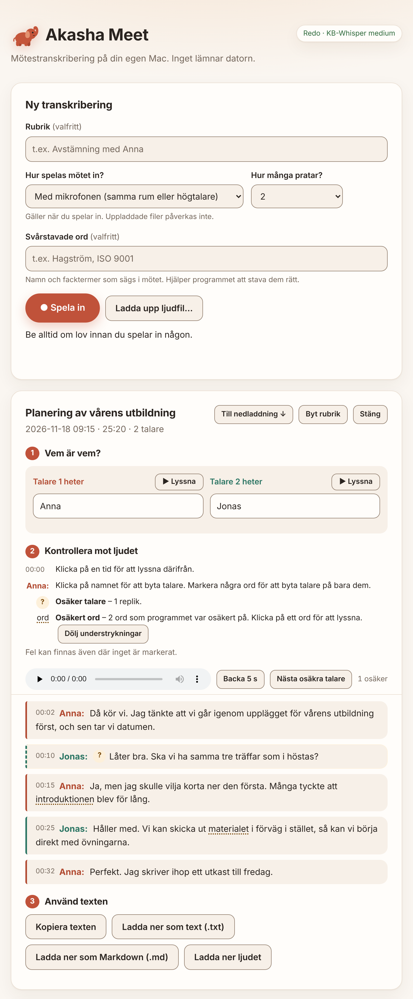

#  Akasha Meet

Transkribera möten på din egen Mac. Spela in direkt i webbläsaren, eller ladda upp en ljudfil.
Du får texten uppdelad per talare och kan byta "Talare 1" och "Talare 2" mot riktiga namn.

- **Allt stannar på datorn.** Tal till text och talaruppdelning görs lokalt. Inget skickas till
  någon molntjänst. Internet används bara en gång, för att hämta modellerna.
- **Svensk taligenkänning** med [KB-Whisper](https://huggingface.co/KBLab/kb-whisper-medium) från
  Kungliga biblioteket. På Mac med Apple Silicon används grafikprocessorn (Metal).
- **Möten i rummet och digitalt.** Med datorns mikrofon, eller Google Meet och Slack i Chrome.
- **Inspelningen tappas inte.** Ljudet sparas på disken var femte sekund under mötet. Svarar inte Akasha Meet en stund sparas ljudet i webbläsarfliken under tiden.

Akasha Meet är ett program som du öppnar som vilket annat som helst. Själva sidan visas i webbläsaren.

<picture>
  <source media="(prefers-color-scheme: dark)" srcset="docs/bilder/akasha-meet-mork.png">
  
</picture>

<sub>Exemplet är påhittat.</sub>

## Använda

1. Öppna **Akasha Meet** i Program. Webbläsaren öppnas på sidan av sig själv. Har du installerat från
   Terminal går du i stället till **http://127.0.0.1:8611** i Chrome (eller Safari). Spara gärna
   sidan som bokmärke.
2. Välj **Hur spelas mötet in?** och **Hur många pratar?**. Skriv gärna namn och facktermer som
   sägs i mötet under **Svårstavade ord**, så stavas de rätt.
3. Tryck **Spela in**. När mötet är slut trycker du **Stoppa och transkribera**. Du kan också
   trycka **Ladda upp ljudfil…** och välja en fil, till exempel från Röstmemon.
4. Vänta medan texten tas fram. Sidan visar hur långt det har kommit och ungefär hur lång tid
   som är kvar.
5. **Vem är vem?** Skriv in vad talarna heter. Namnen sparas av sig själva. Tryck **Lyssna** för
   att höra ett prov på rösten, om du inte vet vem som är vem.
6. **Kontrollera mot ljudet.** Klicka på en tid för att lyssna på just det stället. Ljudspelaren,
   **Backa 5 s** och **Nästa osäkra talare** följer med när du bläddrar i texten.
7. Har en replik fått fel talare? Klicka på namnet i repliken och välj rätt person. Är bara en del
   fel, markera de orden och välj vem som sa dem. Där kan du också säga att alla repliker från en
   talare egentligen är någon annans. **Ångra alla rättningar** tar texten tillbaka till hur den
   var efter transkriberingen.
8. Börja kontrollen med de osäkra ställena. Ovanför texten står vad markeringarna betyder.
   Repliker där talaren är osäker har ett **?** och streckad kant, och **Nästa osäkra talare**
   hoppar mellan dem. Stämmer talaren, klicka på **?** eller namnet och välj **… stämmer**, så
   försvinner markeringen. Ord som programmet var osäkert på är understrukna, ofta namn och
   ovanliga ord. Klicka på ett sådant ord för att lyssna. Markeringarna är en hjälp att veta var
   du ska börja, inte en garanti: fel kan finnas även där det inte är markerat.
9. **Använd texten.** Tryck **Kopiera texten**, eller **Ladda ner som text (.txt)** eller
   **Ladda ner som Markdown (.md)**. **Ladda ner ljudet** sparar ljudet som en fil.

Inspelningen heter "Möte" och datum om du inte skriver en rubrik. Du kan skriva rubriken medan
mötet pågår: det som står i fältet när du trycker **Stoppa och transkribera** gäller. Rubriken går
att byta efteråt med **Byt rubrik**. Filnamnet på en uppladdad fil används aldrig, eftersom
Röstmemon döper inspelningar efter platsen (en gatuadress).

Vill du transkribera en inspelning en gång till, till exempel med ett annat antal talare? Tryck
**Transkribera igen** i listan, ändra det som behövs och tryck **Transkribera**. Har du rättat
talarna för hand försvinner de rättningarna, och sidan säger till först.

### Med mikrofonen

För möten i samma rum, eller digitala möten där du har högtalare på. Mikrofonen fångar alla som
hörs i rummet.

- Ställ datorn mellan er. Mikrofonen behöver höra alla ungefär lika bra.
- Är du med i ett digitalt möte via högtalare blir de andras röster något sämre än i det digitala
  läget nedan.

### Digitalt i Chrome (Google Meet, Slack)

När du trycker **Spela in** frågar Chrome vilken flik som ska delas: välj fliken med mötet och
kryssa i **Dela även flikljud**. Det fungerar med hörlurar, och med alla möten i en Chrome-flik:
Google Meet, en Slack-huddle i Slack i Chrome (`app.slack.com`), Teams eller Zoom i webbläsaren.

- Din mikrofon och mötet spelas in i varsin kanal. Det du säger blir därför alltid **Du**, och bara
  de andra behöver delas upp efter röst.
- Räkna med dig själv i "Hur många pratar?". Tre betyder du och två till.
- Det fungerar bara i Chrome och andra Chromium-webbläsare. Safari och Firefox kan inte dela
  ljudet från en flik, så där går valet inte att välja.
- Möten i **apparna** (Slack-appen, Teams, Zoom) har ingen flik att dela. Öppna mötet i Chrome,
  eller använd högtalare och **Med mikrofonen**. En Mac-hjälpare som hämtar ljudet direkt från
  apparna finns som förslag i [#1](https://github.com/jamesmcstrid/Akasha-Meet/issues/1).

### Bra att veta

- **Be alltid om lov innan du spelar in någon.** I ett digitalt möte ser de andra inte att du
  spelar in, som de gör när Meet själv spelar in. Säg till.
- Låt fliken vara öppen och datorn vaken. Om locket stängs slutar inspelningen.
- Under inspelningen visar **Ljudnivå** att ljud kommer in, och flikens namn visar att du spelar
  in. Hörs inget ljud på ungefär tio sekunder varnar sidan. Kontrollera då att rätt mikrofon är
  vald och att den inte är avstängd.
- Medan texten tas fram somnar datorn inte av sig själv. Stänger du locket pausas
  transkriberingen och fortsätter när du öppnar det igen.
- Svarar inte Akasha Meet under en inspelning fortsätter inspelningen, och ljudet sparas i fliken tills Akasha Meet är igång igen. Stäng inte fliken då. Trycker du Stoppa medan ljud väntar, startar transkriberingen när allt har kommit fram. Vill du inte vänta, tryck Spara ljudet som fil och sedan Klar, och ladda upp filen senare med Ladda upp ljudfil.
- Om fliken stängs eller datorn startas om ligger inspelningen kvar i listan som "Spelar in".
  Tryck **Avsluta och transkribera**, så transkriberas det som hann sparas.
- Kontrollera texten mot ljudet innan du använder den. Taligenkänning gör fel, särskilt på namn,
  siffror och när flera pratar samtidigt.

### Hur lång tid tar det?

På en MacBook Air med Apple Silicon tog ett möte på 1 timme och 24 minuter 12 minuter att
transkribera och dela upp per talare, alltså drygt 8 minuter per timme möte. Medan texten tas
fram visar sidan ungefär hur lång tid som är kvar.

## Installera

### Som program (prov, Mac med Apple Silicon)

Programmet byggs i GitHub Actions och är ännu inte signerat av Apple. Det kräver en Mac med Apple
Silicon (M1 eller senare) och macOS 14 eller senare.

1. Öppna repot på GitHub, gå till **Actions → Mac-app**, välj den senaste gröna körningen och ladda
   ned **Akasha-Meet-mac-arm64.zip** under **Artifacts**.
2. Öppna zip-filen i Hämtade filer om Safari inte redan har gjort det, och dra **Akasha Meet** till
   **Program**.
3. Dubbelklicka på Akasha Meet. Första gången säger macOS att "Akasha Meet" öppnades inte, eftersom
   Apple inte kunde verifiera att den är fri från sabotageprogram. Tryck **Klar**. (Den förvalda
   knappen är Flytta till papperskorgen; tryck inte på den.)
4. Välj Apple-menyn > Systeminställningar och klicka på **Integritet och säkerhet** i sidofältet (du
   kanske måste rulla nedåt). Under rubriken **Säkerhet** står "Akasha Meet" blockerades för att
   skydda din dator. Tryck **Öppna ändå** på den raden. (På en del versioner av macOS heter knappen
   där **Öppna**; tryck i så fall på den.) Knappen finns i omkring en timme efter att du försökte
   öppna appen. Saknas den, gör om steg 3.
5. En ruta frågar Vill du öppna "Akasha Meet"? Tryck **Öppna ändå**.
6. Bekräfta med Touch ID, eller tryck **Använd lösenord…** och ange ditt lösenord. Det behövs bara
   första gången; sedan öppnas Akasha Meet med dubbelklick som andra program. Apple beskriver stegen
   i
   [Öppna en Mac-app från en okänd utvecklare](https://support.apple.com/sv-se/guide/mac-help/mh40616/mac).
7. Sidan öppnas och erbjuder att hämta modellerna (cirka 1,6 GB, bara första gången). Har du
   installerat från Terminal tidigare används de modeller du redan har (se nedan).

Säger macOS i stället att programmet är skadat, eller syns ingen rad om Akasha Meet under Säkerhet
direkt efter ett försök att öppna det, kör en gång i Terminal:
`xattr -dr com.apple.quarantine "/Applications/Akasha Meet.app"` och öppna programmet igen.

**Igång och avsluta:** när Akasha Meet är igång har ikonen i Dock en prick under sig. Klicka på
ikonen för att öppna sidan igen. Avsluta med **⌘Q** eller genom att högerklicka på ikonen och välja
**Avsluta**. Det du redan spelat in ligger kvar.

**Har du installerat från Terminal tidigare** frågar programmet om det ska ta över. Då stängs den
gamla installationen av och startar inte längre när du loggar in. Inspelningarna i `~/AkashaMeet`
och modellerna du redan har används av programmet, så ingenting hämtas igen. Vill du ha tillbaka den
gamla kör du `bash mac/installera.sh` igen. Ligger den gamla mappen i Hämtade filer, Dokument eller
Skrivbord letar programmet inte efter modeller där (macOS skulle annars fråga om lov), utan erbjuder
att hämta dem. Flytta mappen till hemkatalogen först om du vill slippa hämta igen.

### Från Terminal

Kräver: en Mac (helst Apple Silicon), [Homebrew](https://brew.sh) och cirka 4 GB ledigt utrymme.
Repot är privat, så du behöver läsrätt till det och en SSH-nyckel kopplad till ditt GitHub-konto.
Öppna Terminal och kör:

```bash
brew install python@3.12 git
git clone git@github.com:jamesmcstrid/Akasha-Meet.git ~/akasha-meet
cd ~/akasha-meet
bash mac/installera.sh
```

Mappen ska ligga direkt i din hemkatalog, som `~/akasha-meet` ovan, och inte i Hämtade filer,
Dokument, Skrivbord eller iCloud Drive. Där låter macOS inte bakgrundstjänster läsa, och
installationen säger ifrån. Har du laddat ned repot som zip-fil, flytta den uppackade mappen till
hemkatalogen innan du kör installationen.

Installationen skapar en Python-miljö och laddar ner modellerna (cirka 1,6 GB, bara första gången).
På Apple Silicon installerar den också `whisper-cpp` via Homebrew, så att grafikprocessorn används.
Den lägger in tjänsten så att den startar när du loggar in, och öppnar webbsidan. Första gången
du spelar in frågar webbläsaren om lov att använda mikrofonen.

Saknas en modell när tjänsten startar, till exempel efter att du har valt `MODELL=large`, visar
sidan vad som behöver hämtas, hur stort det är och varifrån det kommer. Tryck **Hämta nu**, så
hämtas och kontrolleras det utan att du behöver starta om något. En avbruten hämtning fortsätter
där den slutade nästa gång.

Kontrollera att allt fungerar (tar några minuter):

```bash
bash halsokoll/prov.sh
```

Alla rader ska börja med `OK` och sista raden ska vara `PROV: OK`. Provet transkriberar
testljuden i `testljud/` och raderar sina provinspelningar efteråt.

**Uppdatera:** `cd ~/akasha-meet && git pull && bash mac/installera.sh`

**Avinstallera:** `bash mac/avinstallera.sh`. Tjänsten stoppas, men inspelningar och modeller ligger
kvar tills du tar bort dem själv.

## Var hamnar inspelningarna?

I mappen `~/AkashaMeet` i din hemkatalog. Bara ditt konto kommer åt mappen. För varje inspelning
finns ljudet, en `.md` med texten och en `.json` med uppgifterna. **Radera** i listan tar bort alla
tre. Det gäller både programmet och installationen från Terminal.

Mappen ligger medvetet inte i Dokument eller på Skrivbordet, eftersom de ofta synkas till iCloud.
Vill du ha den någon annanstans anger du `DATAKATALOG` i inställningarna (se nedan).

## Integritet och säkerhet

- Tjänsten lyssnar bara på `127.0.0.1`. Ingen annan dator i nätverket kommer åt den.
- Akasha Meet använder internet bara för att hämta modellerna, en gång: när du trycker **Hämta nu**
  på sidan eller kör installationen. Filerna kommer från Hugging Face (huggingface.co), med låsta
  versioner, och varje fil kontrolleras med sha256 innan den används. Programmet följer bara
  vidarekopplingar till Hugging Faces egna adresser, över https. Inga inspelningar, texter eller
  uppgifter om dig skickas, varken då eller senare.
- Andra webbsidor du har öppna kan inte styra tjänsten. Den svarar bara på `localhost`, och allt som
  ändrar något kräver en särskild header som en främmande sida inte får skicka.
- Ingen språkmodell skriver om eller sammanfattar texten. Det whisper hör är det som står.
- Programmet är ännu inte signerat och kontrollerat av Apple. Därför varnar macOS första gången du öppnar det.

## Inställningar

Allt har standardvärden. I programmet ligger inställningarna i filen `installningar.env` i mappen
`~/Library/Application Support/Akasha Meet`. Filen finns inte från början. Skapa den med TextEdit
(Format → Gör till ren text), en inställning per rad, till exempel `MODELL=large`, och avsluta och
öppna Akasha Meet igen. Mappen hittar du i Finder med Gå → Gå till mapp…

Har filen ett fel, till exempel en rad som inte går att förstå eller fel sorts text, säger
programmet till när det startar och använder standardvärdet för just det.

Har du installerat från Terminal gör du det i `.env`, som skapas vid installationen.
Starta sedan om tjänsten med `launchctl kickstart -k gui/$(id -u)/local.akasha-meet`.

| Inställning | Standard | Vad |
|---|---|---|
| `MOTOR` | `auto` | `auto` väljer whisper.cpp med Metal på Apple Silicon och faster-whisper på processorn annars. Går att tvinga med `whispercpp` eller `faster` (starta om Akasha Meet; sidan erbjuder att hämta det som saknas). `faster` går inte i programmet, där följer faster-whisper inte med |
| `MODELL` | `medium` | `large` gör färre fel men tar längre tid och behöver 1,1 GB till (3,1 GB utan Apple Silicon). Starta om Akasha Meet efter att du ändrat. Sidan erbjuder då att hämta modellen |
| `ORDLISTA` | tom | Ord som alltid ska stavas rätt, till exempel företagets namn |
| `DATAKATALOG` | `~/AkashaMeet` | Var inspelningar och texter sparas |
| `PORT` | `8611` | Webbsidans port |
| `TALARE_TROSKEL` | `0.6` | Två röster som liknar varandra mer än så räknas som samma person (0–1) |
| `MAX_MB` | `1024` | Största fil som går att ladda upp |

## Felsökning

| Problem | Gör så här |
|---|---|
| Sidan öppnas inte | Programmet: avsluta och öppna Akasha Meet igen. Loggen finns i `~/Library/Logs/Akasha Meet/akasha-meet.log` (öppnas med appen Konsol). Från Terminal: `launchctl kickstart -k gui/$(id -u)/local.akasha-meet`, och loggen `~/AkashaMeet/akasha-meet.log` |
| "Operation not permitted" i loggen, eller installationen säger att mappen ligger fel | Mappen med Akasha Meet ligger där macOS inte låter bakgrundstjänster läsa (Hämtade filer, Dokument, Skrivbord, iCloud Drive). Flytta den till hemkatalogen, ta bort mappen `venv` i den, och kör `bash mac/installera.sh` igen. Modellerna och .env följer med. |
| "Akasha Meet svarar inte" | Programmet har avslutats eller stannat. Öppna Akasha Meet igen. Från Terminal: tjänsten startar av sig själv när du loggar in, så logga ut och in igen, eller kör `launchctl kickstart -k gui/$(id -u)/local.akasha-meet` i Terminal. Det du redan spelat in ligger kvar. Sidan märker själv när Akasha Meet är igång igen. |
| "Akasha Meet" öppnades inte, eller "är skadat" | Se steg 3–6 under Som program: Klar, sedan Öppna ändå under Integritet och säkerhet → Säkerhet. Säger macOS att programmet är skadat, kör `xattr -dr com.apple.quarantine "/Applications/Akasha Meet.app"` i Terminal. |
| "Akasha Meet kan inte starta" (port 8611) | Ett annat program använder porten. Avsluta det, eller ange en annan port med `PORT=` i inställningarna. |
| "Akasha Meet startade inte" | Tryck **Visa loggen** och läs de sista raderna, eller skicka dem till den som hjälper dig. Loggen innehåller inga inspelningar eller texter. |
| "Inte redo" uppe till höger | Håll muspekaren över texten för att se orsaken. Det är något som en hämtning inte kan rätta, till exempel en inställning i `.env` eller `installningar.env`. |
| "Modellerna behöver hämtas" uppe till höger | Tryck **Hämta nu** i rutan överst på sidan. Det görs bara en gång. |
| Hämtningen säger "Kunde inte nå Hugging Face" | Kontrollera att datorn är ansluten till internet och tryck **Försök igen**. Det som redan hämtats ligger kvar. |
| Hämtningen fungerar inte på ett företagsnät (certifikatfel eller inget svar) | Lägg in nätets proxy i inställningarna, till exempel `HTTPS_PROXY=http://proxy.foretaget.se:8080`, och vid behov företagets certifikat med `REQUESTS_CA_BUNDLE=/sökväg/till/certifikat.pem`. Avsluta och öppna Akasha Meet igen (från Terminal: starta om tjänsten), och tryck **Försök igen**. Programmet använder Macens egna certifikat, så företagets certifikat behövs oftast inte. |
| "Det får inte plats på disken" | Frigör utrymme och tryck **Försök igen**. Sidan visar hur mycket som behövs. |
| "Kontrollsumman stämmer inte" | Filen har tagits bort. Tryck **Försök igen**. Händer det igen kan filen ha ändrats hos Hugging Face. |
| `Bootstrap failed: 5` vid installation | Uppdatera (`git pull`) och kör `bash mac/installera.sh` igen. Hjälper inte det: Systeminställningar → Allmänt → Inloggningsobjekt, tillåt `bash` i bakgrunden |
| "Fick inte tillgång till mikrofonen" | Tillåt mikrofonen för sidan i webbläsarens inställningar, och för webbläsaren i Systeminställningar → Integritet och säkerhet → Mikrofon |
| Texten är inte uppdelad per talare | Tryck **Transkribera igen** i listan och välj fler än 1 under "Hur många pratar?" |
| Fel antal talare, eller "bara 1 röst gick att skilja åt" | Tryck **Transkribera igen** i listan och välj rätt antal. Ange inte fler än som pratar; är du osäker, välj **Vet inte – gissa**. Rösterna skiljs lättare åt om ni sitter på ungefär samma avstånd från datorn. Är ni många i rummet hjälper en konferensmikrofon mitt på bordet |
| Du vill visa någon hur det gick, utan att dela texten | `bash halsokoll/sammanfatta.sh` skriver ut tider, talare och tecken på fel, men inga ord ur mötet. `bash halsokoll/talardiagnos.sh` visar varför det blev så många talare, och `bash halsokoll/jamfor.sh <id A> <id B>` jämför två transkriberingar av samma möte. Se [docs/TEKNIK.md](docs/TEKNIK.md) |
| "Ljudet kan inte sparas på datorn" | Tryck Spara ljudet som fil och sedan Klar. Ladda upp filen med Ladda upp ljudfil och radera den ofullständiga inspelningen i listan. |
| "Inget ljud hörs" under inspelningen | Kontrollera att rätt mikrofon är vald och inte avstängd: i webbläsarens inställningar och i Systeminställningar → Ljud → Ingång |
| Transkriberingen misslyckades | Öppna inspelningen och tryck **Försök igen** |
| Mötesljudet saknas i ett digitalt möte | Kryssade du i **Dela även flikljud**? Det går bara i Chrome. Gör en ny inspelning |
| Inspelningen fastnade på "Spelar in" | Tryck **Avsluta och transkribera** i listan |

## Teknik och utveckling

Hur det fungerar inuti, hur talaruppdelningen utvärderades och vad som är testat står i
[docs/TEKNIK.md](docs/TEKNIK.md). Enhetstesterna körs med
`venv/bin/python -m unittest discover -s tester`. `venv/bin/python tester/forsta_start.py` startar
sidan som vid första start, med en låtsaskälla i stället för Hugging Face.

Programmet för Mac byggs med `paketering/` och GitHub Actions (se [docs/TEKNIK.md](docs/TEKNIK.md)).
`python app/start.py` startar tjänsten och webbläsaren utan programmet.

## Källor och licenser

| Del | Licens |
|---|---|
| Akasha Meet (det här programmet), © 2026 Dennis Fredin | Apache-2.0, se [LICENSE](LICENSE) och [NOTICE](NOTICE) |
| [KB-Whisper medium](https://huggingface.co/KBLab/kb-whisper-medium) (KBLab, Kungliga biblioteket) | Apache-2.0 |
| [faster-whisper](https://github.com/SYSTRAN/faster-whisper), [whisper.cpp](https://github.com/ggml-org/whisper.cpp) (följer med programmet) | MIT |
| [sherpa-onnx](https://github.com/k2-fsa/sherpa-onnx) | Apache-2.0 |
| [PyAV](https://github.com/PyAV-Org/PyAV) med FFmpeg, Python, Flask, numpy, PyObjC och de andra delarna i programmet | Var och en sin licens. En förteckning läggs till innan programmet släpps |
| NeMo TitaNet small (NVIDIA), via sherpa-onnx | CC-BY-4.0 |
| Testljud: [Google FLEURS](https://huggingface.co/datasets/google/fleurs) | CC-BY-4.0 |
